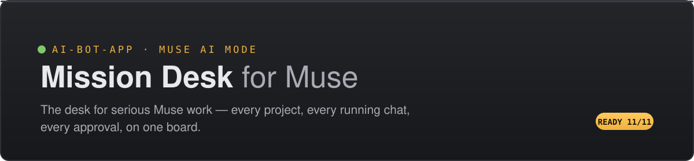

<p align="center">
  
</p>

<p align="center">
  
  
  
  
</p>

**The desk for serious Muse work.** If you run Muse across several projects at once — code, a book, a research programme — Mission Desk lets you conduct all of it from one board: what's running, what needs you, what's next, with every conversation kept under its project and filed your way.

> **The full guide is one file:** [`introduction.html`](introduction.html) — download it and open it in a browser. It's a self-contained interactive manual (install walkthrough, the 11 checks explorer, troubleshooting). GitHub shows its source here; the file itself is the rendered version.

---

## Who it's for

- **The multi-project builder** — several codebases on the go, each with its own chats and review queue, and every project's state (including what's built and waiting on your word to push) visible without opening five threads.
- **The long-haul maker** — a book, a course, a research programme: work measured in chapters and months, held in shape as a project with drafts as artifacts and sessions as tasks.
- **The parallel operator** — three chats running is a normal afternoon. Finished work announces itself (a badge, a Needs You entry) instead of being discovered by polling every thread.

Everything Muse is good at stays in Muse — memory, search, scheduling, connectors, artifacts. The desk adds the layer that's about **you**: your projects and their statuses, your filing, your call on every proposal. The agent proposes filings, retitles and schedule entries; you accept or reject. Nothing is applied silently.

## How it fits together

| Piece | What it does |
|---|---|
| **muse.ai tab** (your browser) | You open it and sign in, as always. The extension's content script rides inside it — observing and operating the page, drawing nothing on it. |
| **Bridge** (`bridge/`, 127.0.0.1:7701) | A small local Node process relaying between the extension and the app — the two tabs can't talk across origins — and hosting the app's records. It also tracks whether the Muse tab is really there. |
| **Mission Desk app** (`src/`) | The board, conversations database, schedule and artifacts, served from your machine at localhost:4173. |
| **Extension** (`extension/`) | The fuse: health checks, typing into the real composer with send-confirmation by observation, streamed replies settled to exactly one final, approval resolution by clicking the page's real controls, Activity mirroring. Selectors live in one config file, `extension/selectors.js`. |

The extension **never reads cookies, tokens, passwords, or any credential** — page DOM only, in a tab you signed into yourself. Full design: [`DESIGN.md`](DESIGN.md); the extension's own notes: [`extension/README.md`](extension/README.md).

## Quick look (no setup)

```bash
npm install
npm run dev
```

Runs the full app against a simulated adapter — everything on the board works; only the agent is a mock.

## Install (the real fuse)

Prerequisites: Node 20+, Chrome with Developer mode available, a muse.ai account you sign into yourself.

```bash
# 1 — dependencies
npm install && (cd bridge && npm install)

# 2 — start the bridge (leave it running; first run writes bridge/.pairing.json)
(cd bridge && npm start)
```

3. **Load the extension:** `chrome://extensions` → Developer mode → **Load unpacked** → this repo's `extension/` folder.
4. **Pair it:** click the extension's toolbar icon, paste the token from `bridge/.pairing.json` → popup should say “Bridge: connected”.
5. **Open [muse.ai](https://muse.ai)** in a tab and sign in. The tab registers itself.
6. **Run the app:**

```bash
npm run build && npx vite preview
```

Open **http://localhost:4173/?adapter=muse** — the lamp walks to *ready* and the connection popover shows **11/11 checks** with your agent's name as identity.

## The 11 checks

The status is *derived* from these checks and nothing else, so it can never claim more than the evidence. Eight are required for ready; three are optional capabilities. A failed check names what wasn't found — that name is the diagnosis, and on the real page it's usually one selector to tune in `extension/selectors.js`.

| Check | Watches |
|---|---|
| Bridge reachable · Extension connected | The local relay and the extension's pairing |
| Muse tab found · Muse page ready | A muse.ai tab, freshly present (it heartbeats; close it and this fails within moments) |
| Signed in | Your agent's identity showing in the page |
| Composer found · Message list found · Reply observer armed | The send path and the streaming-receive path |
| Approval observer · Activity observer · Activity panel observer *(optional)* | Permission requests and the Activity view, mirrored to the board |

## Where things stand

| Capability | Status |
|---|---|
| Connect, send, stream, exactly-one-final | **Proven on the real muse.ai** — [calibration report](docs/CALIBRATION-REPORT.md), [DOM survey](docs/survey/muse-ai-dom-survey.md) |
| Tab presence (close the tab → the app drops out of ready; reopen → it recovers, draft kept) | **Proven** — driven probe `scripts/probe-presence.mjs`, protocol in DESIGN.md §6.6 |
| Approvals from Needs You (once / always scopes) | Proven against the fixture; no genuine request occurred during calibration to exercise it on the real page |
| Activity → Running Now / Recently Finished | Panel mapped on the real page; it carries scheduled-task history there, and entry-level mapping is deliberately conservative |
| Monitor / email / database resources | Registry + per-bot toggles only — data flows are a later slice, and the registry says so up front |

## Ground rules

- **Your session stays yours** — no credential material is read, ever; if a step seemed to need it, the design says stop.
- **Everything is local** — bridge on localhost only, pairing token only in `bridge/.pairing.json` + extension storage, records on your machine.
- **Brittle, and plain about it** — the fuse is unsupported by design; when muse.ai changes, a named check fails and tells you what to tune, instead of the app quietly misbehaving.
- **Activity is transient** — it mirrors onto the board and is never written into records.

## Reading further

- [`introduction.html`](introduction.html) — the full interactive guide (download + open in a browser)
- [`DESIGN.md`](DESIGN.md) — adapter contract (§5), status model (§6), the fuse (§9), every decision and its reasons
- [`docs/muse-code-calibration-brief.md`](docs/muse-code-calibration-brief.md) — how the real-page calibration was assigned and audited
- [`reference/`](reference/) — the original design seed this repo grew from
